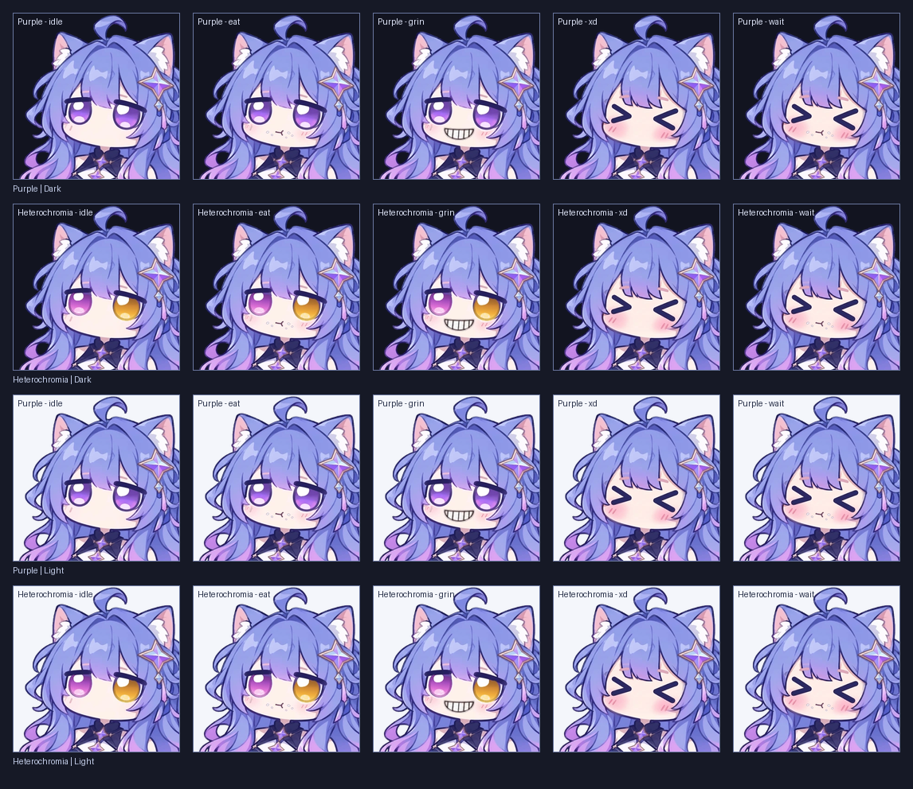

# Gemini 猫娘观察台 · 反重力观察窗（Antigravity Observer v1.4.0）

> 专为 **Google Antigravity**（已实测适配 `2.35.2`）打造的应用内紧贴右下角 **Gemini 猫娘桌面挂件**与**上下文 / Token / 额度观察窗**（GitHub 仓库：`antigravity-observer`，插件 ID：`gemini-neko-cockpit`，兼容保留 `AG_ZH` 中文汉化补丁）。

[](https://github.com/yunjuanyunshu114-byte/antigravity-observer/releases)
[](https://github.com/yunjuanyunshu114-byte/antigravity-observer)
[](#第二步执行安装)
[](./LICENSE)

在 Antigravity 客户端右下角静默陪伴你的专属 **Gemini 猫娘挂件**——平时仅显示贴边主形象，AI 思考时自动切换「吃大米」差分，**出现审查需求、权限确认或提问提示时立即切换专属「确认提醒」差分、响起提示音效并冒泡点名请求主人确认的项目（确认后自动结束并恢复原本状态）**，戳一戳触发 `><` 表情、Q 弹动画、音效与三段式思考气泡，**每轮模型对话结束自动冒泡 10 秒播报本轮消耗额度**；同时保留输入框下方紧凑统计胶囊、可滚动上下文深度观察窗以及 Sidecar 原生侧栏面板。


---

## 📋 v1.4.0 版本特性总览

### 1. 应用内紧贴右下角 Gemini 猫娘挂件
- **无打扰静默待机**：紧贴窗口右下角（`0px` 贴边），平时仅展示统一无鲸鱼耳猫娘头发与蓝紫发色、透明抠图处理的 Gemini 娘主形象，不常驻额外按钮或遮挡工作区。
- **内置两套默认皮肤一键切换**：统一以干净猫娘立绘为基底制作五帧面部表情差分，可在「挂件设置」中随时切换 **`💜 经典紫瞳`** 与 **`💗💛 粉金异瞳`**。
- **五帧表情差分自动联动**：
  - **平时待机 (`idle`)**：主形象立绘，伴随柔和呼吸微动；
  - **AI 思考 / 生成中 (`eat`)**：自动识别会话运行态或发送按钮取消态，切换「吃大米」差分；
  - **审查 / 确认 / 提问提示 (`wait`)**：实时结合 Language Server `waitingSteps`（支持跨项目工作区后台会话）与前端确认控件（`inline-permission-card`、`inline-card`、`ask-question`、`subagent-approve`、`Proceed` 审查卡等），自动切换专属鼓嘴 `><` 确认提醒差分并轻跳提示；
  - **戳一下 (`xd`)**：触发 `><` 差分、Q 弹按压回弹与离线合成音效（含爱心/星星粒子反馈）；
  - **对话完成 / 三连戳彩蛋 (`grin`)**：本轮输出完成或连续戳 3 下时触发「呲牙笑」差分与彩蛋音效。
- **审查与确认实时提醒气泡（不可点击穿透 + 4 秒自动收起）**：
  - 当任意项目触发命令/权限审批、方案审查确认、接管确认或问题询问时，立即播放专属铃音 `review_alert.wav` 并弹出琥珀高亮边框气泡，明确显示 **`【项目名】请求主人确认啦！`** 与具体待确认类型（`权限/命令待确认`、`审查需求待确认`、`提问等待主人回答` 等）；
  - 为避免遮挡「提交 / 确认」按钮，提醒气泡**完全不可点击穿透**并在 **4 秒后自动收起**，猫娘保持 `wait` 差分直到主人点击「Allow / Proceed / Submit / 确认」后无缝切回对应的思考（`eat`）或待机（`idle`）状态（不会误触发回合结束播报）。
- **左键三段式椭圆思考气泡**：
  1. **第 1 次左键点击形象**：弹出椭圆思考气泡，展示当前主模型 **5h / 每周剩余额度**、重置倒计时、**上下文占用**与 **已用 Token**（同时触发 `><` 差分与音效）；
  2. **第 2 次左键单击气泡**：切换展示猫娘随机台词（内置台词 + 用户自定义台词，支持实时变量占位符）；
  3. **第 3 次左键点击气泡**：收起关闭气泡（切换至其他区域或重新触发亦会自动管理）。
- **每轮对话完成自动播报（10 秒自动关闭）**：
  - 每次模型思考生成结束后，自动弹出椭圆气泡展示**本轮消耗额度变化（如 `5h -1.8%`）**、最新剩余额度与**本轮新增 Token**，**10 秒后自动收起**（也可点击气泡提前关闭，支持在设置中开关）。
- **右键遥测详情卡片 · 📅 每日 Token 统计 · 独立「⚙️ 挂件设置」面板**：
  - **右键点击形象**打开完整详情浮窗（上下文长度 + 服务端分桶构成 + 本对话 Token 与缓存命中率 + 模型 5h / 周剩余额度），底部提供 **`📅 每日 Token`**（近 18 周贡献热力图 + 点击单日详情 + **`📊 详情`** 7/14/30 天完整分解弹窗，感谢 PR #7 [@Akar1Sk](https://github.com/Akar1Sk)）、**`🔍 上下文观察窗口`**、**`🔄 刷新`** 与独立的 **`⚙️ 挂件设置`** 按钮。
  - 修复深度推理模型把思考 Token 或轮询延迟计入生成速度导致的 `tok/s` 虚高问题（改用 `responseOutputTokens` 中位数采样，Windows `.bat` 一键脚本亦已通过 `.gitattributes` 统一为 CRLF）。
  - **挂件设置支持全部个性化定制**：
    - 📏 **挂件大小**（`64px` ~ `180px`，默认 `112px`）与 👁 **透明度**（`35%` ~ `100%`）滑块实时预览；
    - 💭 **气泡大小** 按钮调节（`－` / `小` / `默认` / `大` / `超大` / `＋`，支持 `65%` ~ `160%` 实时缩放）；
    - 🎨 **默认皮肤**：内置 **`💜 经典紫瞳`** 与 **`💗💛 粉金异瞳`** 两套统一基底五帧差分皮肤一键切换；
    - 🖼️ **自定义形象**：分别上传修改 `更改主形象` / `思考差分` / `戳一戳差分` / `彩蛋差分` / `确认差分`，支持一键 `↺ 恢复默认`；
    - 💬 **自定义气泡对话**（输入框 + `+ 添加对话` 按钮，支持逐条删除与动态数据占位符）；
    - ⚠️ **审查/确认提醒开关 & 确认提醒音效开关**；
    - 🔊 **戳一下声音**（内置 **Q 弹叮咚** / **软萌喵呜** / **小黄鸭** 离线合成 WAV + **选本地音频**，支持音量调节、静音与 60s 空闲挂起 + IME 输入法组字避让）；
    - 📍 **四分贴边停靠**：直接按住拖拽至窗口任意边缘自动贴边吸附（靠左自动水平翻转），或点击按钮快速停靠 `右下角` / `左下角` / `右上角` / `左上角`。

### 2. 输入框统计栏 · 上下文深度观察窗 · Sidecar 侧栏
- **输入框下方 15px 紧凑统计栏**：位于 `[data-testid="agent-input-box"]` 下方，紧凑显示轮次/步数、实时 `tok/s`、累计 Token、精准缓存命中率与上下文占比（可在「挂件设置」中随时显示/隐藏）。
- **可滚动反重力上下文观察窗口**：点击统计栏或右键详情卡的 `🔍 上下文观察窗口` 弹出完整模态分析面板，支持切换会话查看 `System / Tools / Chat` 构成拆解、模型额度倒计时、活跃工具估算、已加载 `SKILL.md`、最重步骤 Top 5 与高频读写文件。
- **原生 Sidecar 侧栏面板**：同时注册 Antigravity `AUX_PANE` Sidecar（`sidecar://gemini-neko-cockpit/neko-cockpit/ui.html`）与配套对话 Skill。
- **无损补丁机制**：通过独立分隔块 `// ===== GEMINI_NEKO_HUD_BEGIN =====` ~ `END` 注入 `app.asar` 内的 `dist/main.js` 与 `dist/preload.js` 末尾，自动生成 `.bak` 备份并完整保留 [`antigravity-zh-plugin`](https://github.com/yunjuanyunshu114-byte/antigravity-zh-plugin)（`AG_ZH`）汉化补丁。

---

## 📸 运行效果截图

<table>
  <tr>
    <td width="50%" align="center">
      <br />
      <sub><b>左键第 1 次点击形象</b>：触发 <code>&gt;&lt;</code> 差分、音效与模型额度/上下文气泡</sub>
    </td>
    <td width="50%" align="center">
      <br />
      <sub><b>左键第 2 次点击气泡</b>：切换猫娘随机/自定义对话（第 3 次点击关闭）</sub>
    </td>
  </tr>
  <tr>
    <td width="50%" align="center">
      <br />
      <sub><b>每轮对话结束自动冒泡</b>：触发呲牙笑彩蛋并展示本轮消耗，10 秒自动关闭</sub>
    </td>
    <td width="50%" align="center">
      <br />
      <sub><b>右键信息卡片</b>：查看上下文/Token/额度详情，点击底部 <b>⚙️ 挂件设置</b> 进入设置</sub>
    </td>
  </tr>
  <tr>
    <td width="50%" align="center">
      <br />
      <sub><b>独立挂件设置面板</b>：挂件与气泡大小按钮、自定义形象、<code>+ 添加对话</code> 与音效控制</sub>
    </td>
    <td width="50%" align="center">
      <br />
      <sub><b>上下文深度观察窗口</b>：支持多会话切换、服务端分桶拆解、工具与读写文件统计</sub>
    </td>
  </tr>
</table>

<div align="center">
  <br />
  <sub><b>两套内置默认皮肤 · 五帧统一基底表情差分对比</b>：经典紫瞳（<code>purple</code>）与粉金异瞳（<code>heterochromia</code>）各含待机（idle）、吃大米（eat）、呲牙笑（grin）、戳一下（xd）、确认提醒（wait）在浅色与深色主题下的表现</sub>
</div>

---

## 📦 详细安装指南

### 前置要求
1. 已安装 **Google Antigravity 2.0** 桌面客户端（Windows / macOS / Linux 通用；若安装了中文汉化补丁也可直接叠加，互不冲突）。
2. 已安装 **Node.js 18+**（请在终端或 PowerShell 中执行 `node -v` 确认输出版本号，例如 `v18.x` / `v20.x` / `v22.x`）。

### 第一步：下载源码

方式 A — 使用 Git 克隆（推荐，后续方便 `git pull` 更新）：
```bash
git clone https://github.com/yunjuanyunshu114-byte/antigravity-observer.git
cd antigravity-observer
```

方式 B — 直接下载压缩包：
在 GitHub 本仓库页面右上角点击 **Code → Download ZIP**，解压到本地文件夹（支持含中文的目录路径）。

### 第二步：执行安装

#### 方式 1：Windows 一键双击安装（最推荐）
进入解压或克隆后的文件夹，直接双击运行：
```text
双击安装观察窗补丁.bat
```
批处理脚本会自动执行以下全部操作：
1. 关闭当前可能锁定 `app.asar` 的 Antigravity 进程（若正在运行）；
2. 将 `plugin.json`、`sidecars/neko-cockpit/`、`assets/`（图标、2 套默认皮肤共 10 帧立绘、8 个音效）、`skills/` 等资源同步到 `%USERPROFILE%\.gemini\config\plugins\gemini-neko-cockpit`（若您此前保留过 `hud_prefs.json` 个人配置，会自动无损保留）；
3. 校验并通过 `src/asar_patcher.js` 安全重写 `app.asar` 末尾注入块（不破坏原有汉化与主体代码）；
4. 自动重新启动 Antigravity。

#### 方式 2：命令行安装（Windows / macOS / Linux 通用）

```bash
# 1. 标准安装：部署 Sidecar 资源 + 构建并尝试写入 app.asar
node setup.cjs
```

> **提示（若运行 `node setup.cjs` 时 Antigravity 处于打开状态）**：
> - Windows 下由于 `app.asar` 被运行中的客户端占用，`setup.cjs` 会先完成 Sidecar 插件部署，并把已通过 SHA-256 校验的新版 ASAR 暂存为 `app.asar.neko-staged`；
> - **Windows 可直接一行结束进程、写入并重启**：
>   ```bash
>   node setup.cjs --kill --relaunch
>   ```
> - **或者手动完全退出 Antigravity 后应用暂存包**：
>   ```bash
>   node setup.cjs --apply-staged
>   ```

#### 其他安装选项（按需使用）
```bash
# Antigravity 未安装在默认路径时，手动指定其 resources 目录：
node setup.cjs --install-dir "D:\Programs\Antigravity\resources"

# 仅安装 Sidecar 侧栏（不改动客户端 app.asar，适合只想用右侧伴生面板的用户）：
node setup.cjs --sidecar-only
```

### 第三步：安装状态校验
```bash
# 查看插件文件与 app.asar 补丁注入状态
node setup.cjs --check

# 执行全部 10 项运行契约自检（检查资源同步、ASAR、Transcript/Annotations、Language Server RPC 等）
node setup.cjs --doctor
```
当 `node setup.cjs --check` 返回 `hudMainPatched: true`、`hudPreloadPatched: true` 且 `node setup.cjs --doctor` 显示 `10 passed, 0 warnings, 0 failed` 时，代表已完全安装就绪。

---

## 🚀 运行原理与日常使用说明

### 它是如何运行的？
安装完成后，**无需额外常驻命令行窗口或手动启动后台脚本**：
1. **桌面挂件与观察窗（自动随客户端启动）**：每次打开 **Google Antigravity 2.0** 时，Electron 主进程加载 `hud/main_bridge.js`，渲染窗口自动挂载 `hud/preload_hud.js` 并在当前会话窗口显示右下角 Gemini 猫娘与输入框统计栏。
2. **Sidecar 观测服务（由客户端按需拉起）**：Antigravity 会根据 `sidecars/neko-cockpit/sidecar.json` 自动管理并运行本地 `server.cjs`，负责读取 Antigravity Language Server 实时额度与会话分桶数据；当窗口桥接层处于轻量上下文模式时亦会自动复用相同本地协议进行降级兜底查询。
3. **配置与自定义素材持久化路径**：
   - 配置文件：`%USERPROFILE%\.gemini\config\plugins\gemini-neko-cockpit\hud_prefs.json`（Windows；macOS/Linux 在 `~/.gemini/config/plugins/gemini-neko-cockpit/hud_prefs.json`）
   - 自定义上传形象：`同目录/assets/custom/`
   - 以上个人配置与图片在更新补丁时会被 `setup.cjs` 自动保留。

### 日常操作速查表

| 操作方式 | 触发效果 |
| :--- | :--- |
| **静默待机** | 右下角 `0px` 贴边显示 Gemini 娘主形象，带有微呼吸动画，无多余控件遮挡 |
| **AI 开始思考 / 输出中** | 自动切换为统一配色的 **「吃大米」差分**，并记录本轮开始前的额度与 Token 基线 |
| **审查需求 / 确认或提问** | 立即切换专属 **`wait` 确认差分**、播放 `review_alert.wav` 提示音，并弹出琥珀边框气泡显示 **【项目名】请求主人确认啦！**；点击确认后自动收起并回到 `eat` 或 `idle` 状态 |
| **每次模型对话结束** | 自动弹出椭圆气泡播报 **本轮额度消耗、最新剩余与本轮新增 Token**（10 秒自动关闭），同时触发呲牙笑彩蛋 |
| **左键点击猫娘（第 1 次）** | 播放音效、切换 `><` 差分与 Q 弹动效，并在椭圆思考气泡内展示 **模型额度 / 上下文 / Token** |
| **左键点击气泡（第 2 次）** | 平滑淡入切换显示 **随机台词**（含您在设置中添加的自定义对话） |
| **左键点击气泡（第 3 次）** | 关闭思考气泡 |
| **鼠标左键按住拖拽** | 在窗口内自由拖动位置，松手后自动四分之一边缘贴边吸附（拖至左侧自动水平镜像翻转） |
| **鼠标右键点击猫娘** | 打开 **完整遥测卡片**（上下文长度拆解、Token 累计与命中率、各模型 5h/每周额度），下方可一键进入 **⚙️ 挂件设置** |
| **点击输入框下方统计栏** | 打开 **反重力上下文观察窗口**，支持切换历史对话深入排查 Tool / Skill / File 占用 |
| **Sidecar 面板 / 对话唤起** | 在 Antigravity 对话中提及「打开反重力观察窗」，或打开 `sidecar://gemini-neko-cockpit/neko-cockpit/ui.html` |

### 自定义气泡台词支持的实时变量
在 **`⚙️ 挂件设置 → 💬 自定义气泡对话`** 输入任意台词并点击 **`+ 添加对话`** 时，可在文本中插入以下动态占位符（运行时会自动替换为当前会话的真实数值）：

| 占位符 | 含义 | 示例输出 |
| :--- | :--- | :--- |
| `{quota_5h}` | 当前主模型 5 小时窗口剩余百分比 | `94.6` |
| `{quota_week}` | 当前主模型每周窗口剩余百分比 | `86.2` |
| `{ctx_pct}` | 当前上下文窗口占用百分比 | `36.1` |
| `{ctx_used}` | 当前上下文已用 Token | `184.6K` |
| `{ctx_max}` | 当前上下文窗口上限 | `512K` |
| `{tokens}` | 本对话累计总 Token | `1.86M` |
| `{model}` | 当前会话模型名称 | `Gemini 4 Hydrogen (XHigh)` |

---

## 🔄 更新、卸载与常见排查

### 如何更新插件？
```bash
cd antigravity-observer
git pull origin main
```
随后直接再次双击 [`双击安装观察窗补丁.bat`](./双击安装观察窗补丁.bat)（或执行 `node setup.cjs --kill --relaunch`）即可，原有的自定义形象、气泡台词、大小与音量设置会自动保留。

### 如何安全卸载？
- **Windows**：直接双击 [`双击卸载观察窗补丁.bat`](./双击卸载观察窗补丁.bat)。
- **命令行**：
  ```bash
  node setup.cjs --uninstall --kill --relaunch
  ```
卸载程序会自动清理 `GEMINI_NEKO_HUD` 注入代码与 Sidecar 插件目录，**原有官方文件及中文汉化补丁均不会受到任何损坏**。

### 常见问题排查 (FAQ)
1. **Antigravity 客户端更新版本后，猫娘挂件消失了？**
   客户端官方更新会覆盖原有的 `resources/app.asar`，属于正常现象；只需重新双击一次 [`双击安装观察窗补丁.bat`](./双击安装观察窗补丁.bat) 即可一键恢复（`hud_prefs.json` 中的个人配置还在）。
2. **命令行执行 `node setup.cjs` 提示窗口被占用 / 已暂存 `.neko-staged`？**
   说明 Antigravity 进程仍在运行并锁住了 `app.asar`。只需彻底退出 Antigravity 后执行 `node setup.cjs --apply-staged`，或在 Windows 下直接执行 `node setup.cjs --kill --relaunch`。
3. **修改气泡大小后感觉太小或太大，如何重置？**
   在 **`⚙️ 挂件设置 → 💭 气泡大小`** 直接点击 **`默认`** 按钮（`100% / 222×152`），也可配合左侧 **`－`** / **`＋`** 按 10% 精细微调。
4. **如何检查是否与 `AG_ZH` 汉化补丁冲突？**
   运行 `node setup.cjs --check`，若输出 `"zhLocalizationIntact": true` 即表示汉化与本插件均完整并存。

---

## 📁 目录结构

```text
├── assets/
│   ├── frames/                      # 默认经典紫瞳 5 帧统一基底透明 WebP 立绘 (idle / eat / grin / xd / wait)
│   ├── skins/
│   │   └── heterochromia/           # 内置粉金异瞳 5 帧统一基底透明 WebP 立绘 (idle / eat / grin / xd / wait)
│   ├── sounds/                      # 离线合成音效包 (boing / nya / duck / combo_chime / review_alert)
│   └── logo.png                     # 插件图标 (256x256 RGBA)
├── docs/
│   └── screenshots/                 # 运行效果截图 (01 ~ 08)
├── hud/
│   ├── main_bridge.js               # Electron 主进程桥接、配置迁移持久化、多项目待确认采集、自定义资源选择与 RPC 兜底
│   └── preload_hud.js               # 渲染层注入：右下角 Gemini 猫娘挂件、确认提醒气泡、右键详情卡与观察弹窗
├── sidecars/neko-cockpit/
│   ├── sidecar.json                 # Sidecar 清单 (AUX_PANE)
│   ├── server.cjs                   # 本地观测 HTTP 服务 & Language Server / Transcript 引擎
│   └── ui.html                      # Sidecar 侧栏 Web UI
├── skills/gemini-neko-cockpit/
│   └── SKILL.md                     # 对话内快捷调用 Antigravity Skill
├── src/
│   └── asar_patcher.js              # ASAR 无损重写与 SHA-256 块校验器
├── plugin.json                      # Antigravity 插件元信息 (v1.4.0)
├── setup.cjs                        # 安装 / 暂存 / 状态检查 / 自检 / 卸载主程序
├── LICENSE                          # MIT 开源许可证
├── 双击安装观察窗补丁.bat             # Windows 一键安装脚本
└── 双击卸载观察窗补丁.bat             # Windows 一键卸载脚本
```

---

## 🙏 开源参考与致谢

本项目在交互手感、挂件机制与数据观测架构上参考并致谢以下优秀开源项目：
- [`MeteorNOX/DeepSeek-Balance-Whale-Widget`](https://github.com/MeteorNOX/DeepSeek-Balance-Whale-Widget)（Q 弹按压手感、三段式椭圆思考气泡、每轮消耗冒泡、Web Audio 预解码与空闲挂起、IME 组字避让、四边吸附与左翻）
- [`Void-LifeStream/dsh-gemini-kitten-widget`](https://github.com/Void-LifeStream/dsh-gemini-kitten-widget)（Gemini 猫娘挂件视觉参考、锚点定位与额度展示）
- [`Akar1Sk`](https://github.com/Akar1Sk)（[PR #7](https://github.com/yunjuanyunshu114-byte/antigravity-observer/pull/7)：每日 Token 统计、18 周热力图面板与 7/14/30 天详细分解弹窗）
- [`Sutera-Diffusus/dsh-whale-musume`](https://github.com/Sutera-Diffusus/dsh-whale-musume)（静默待机与互动彩蛋理念）
- [`subamanis/agy-cockpit`](https://github.com/subamanis/agy-cockpit)、[`n2ns/antigravity-panel`](https://github.com/n2ns/antigravity-panel)、[`YashjitPal/BetterGravity`](https://github.com/YashjitPal/BetterGravity)、[`qqxpee/antigravity2-cn`](https://github.com/qqxpee/antigravity2-cn)

---

## 📄 开源协议

本项目基于 [**MIT License**](./LICENSE) 开源，欢迎 Fork、二次修改与公开发布衍生版本（请在分发时保留原始版权与许可声明；参考与复用的上游 MIT 开源组件亦遵循其各自原 MIT 许可）。
